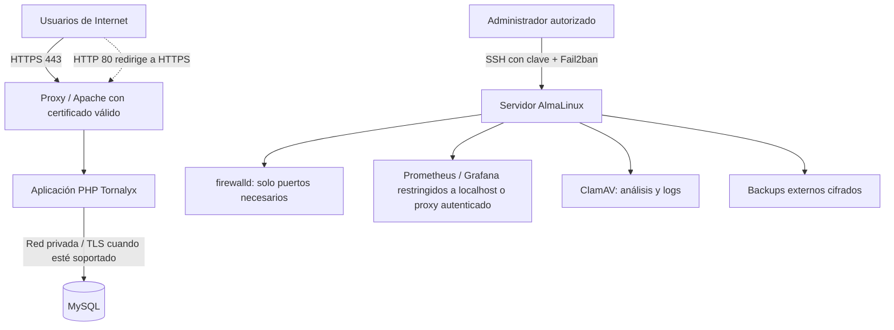

# Esquema de red con controles de seguridad

**Estado:** arquitectura de referencia; ajustar a la topología real del servidor antes de presentarla como desplegada.

## Controles
- No exponer el puerto MySQL a Internet.
- Restringir SSH por identidad y firewall; conservar acceso de recuperación.
- Exponer paneles de monitoreo solo a administradores.
- Registrar alertas y proteger los logs.
- Separar secretos y claves privadas del código y del directorio público.
- Validar TLS y renovación del certificado con el dominio real.

El diagrama representa el diseño objetivo; adjuntar capturas de configuración y pruebas para demostrar la implementación real.
